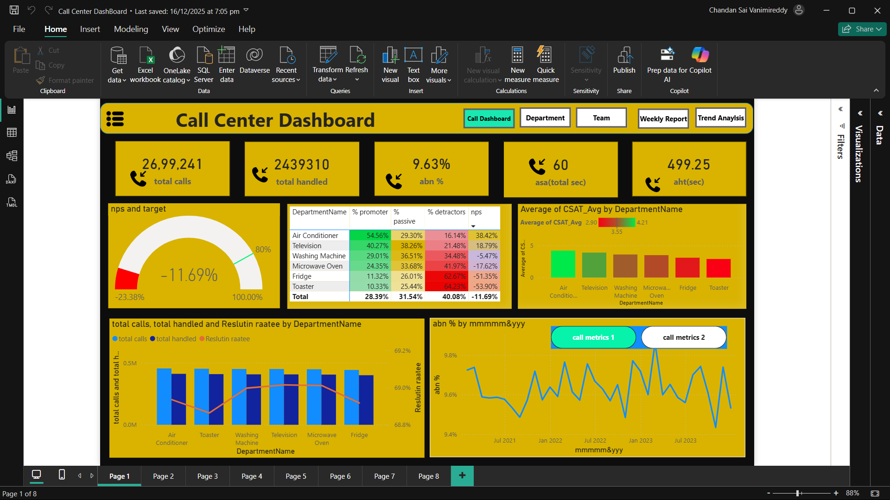
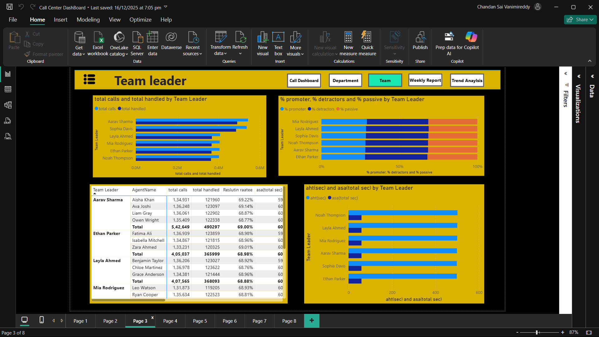
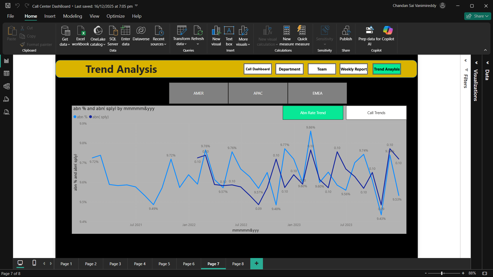

# Power BI Call Centre Dashboard

Interactive Power BI dashboard analyzing call centre performance: call volumes, agent performance, response times, and customer satisfaction trends. The dashboard contains 8 interactive pages with navigation buttons.

## Tech Stack
Power BI, Power Query, DAX, data modeling

## Dashboard Preview

## Contents
- Call volume and trend analysis with KPI cards (total calls, handled, abandonment %, ASA, AHT)
- Agent-wise and team performance metrics
- Department-level CSAT and NPS analysis with gauge visuals
- Response/resolution time tracking
- Weekly reports and trend analysis pages

## How to View
1. Install Power BI Desktop (free from Microsoft)
2. Open the .pbix file in this repository
